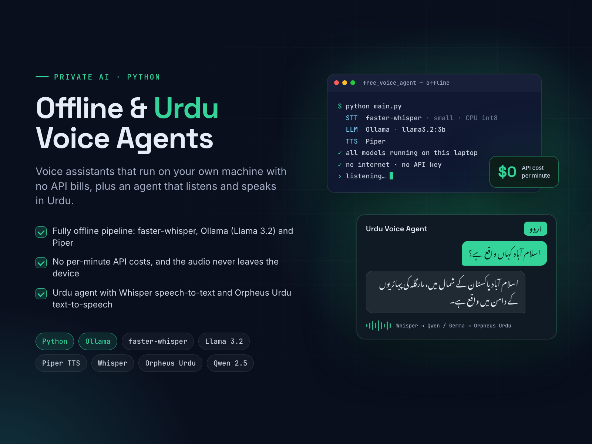

# Offline & Urdu AI Voice Agents

**Whisper, Ollama, Piper, Orpheus**

**Goal:** voice assistants that work without internet or API bills, and one that speaks Urdu.

**Solution:** an offline agent that runs on a laptop CPU: faster-whisper for speech-to-text, Llama 3.2 3B through Ollama for replies and Piper for the voice. A second agent listens and replies in Urdu using Whisper large-v3 turbo and an Orpheus Urdu TTS model, with a lite mode (Qwen 2.5) for 8 GB machines.

**Result:** private voice AI with zero per-minute cost (the offline agent keeps all audio on the device), and a base for Urdu-language assistants.

| | |
|---|---|
| **My role** | Solo developer and AI engineer |
| **Skills** | Python, AI Agent Development, Large Language Model, AI Text-to-Speech, Artificial Intelligence |

## About this repository

This is a showcase repository. It contains the project poster and the poster's own HTML/CSS source in [`poster/`](poster/).
The app's source code is kept private.

To re-render the poster, open `poster/index.html` in Chrome at 1600×1200, or run `poster/render.sh` on macOS.

More of my work: **https://ahsanrazapk.github.io**
